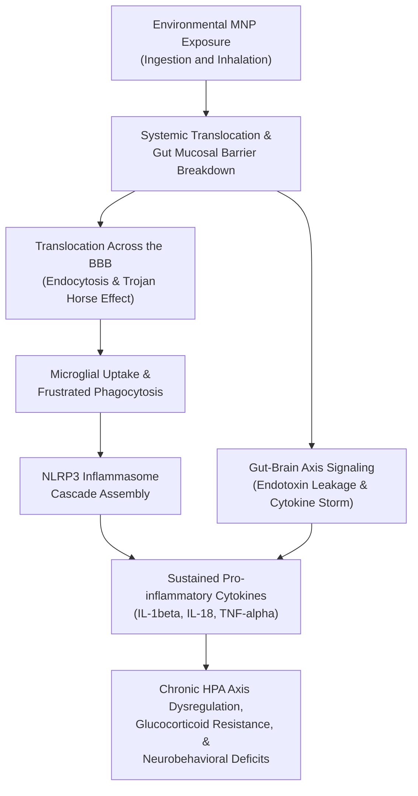

# Micro- and Nanoplastics: Crossing the Blood-Brain Barrier to Drive Sustained Neuroinflammation and HPA Axis Dysregulation

This repository hosts the academic review manuscript examining how environmental micro- and nanoplastics (MNPs) penetrate the Central Nervous System (CNS) and disrupt neuroendocrine homeostasis.

The paper was prepared for the Immunology course (BT335IU) at the School of Biotechnology, International University – Vietnam National University, Ho Chi Minh City.

---

## Access the Manuscript

The complete manuscript is available in multiple formats for online reading, reviewing, and offline archival:

| Format | Access Link | Description |
|:---|:---|:---|
| **Web Article (In-Browser)** | [Read Online via GitHub Pages](https://ht2905.github.io/microplastic-neurotoxicity-paper/) | Interactive web article with a floating table of contents and high-resolution figures. Accessible on any browser or mobile device. |
| **Microsoft Word (.docx)** | [Download Latest Manuscript (.docx)](https://github.com/ht2905/microplastic-neurotoxicity-paper/releases/latest/download/microplastic-neurotoxicity_manuscript.docx) | Formatted Word document with Elsevier Vancouver numbered citations and embedded figures. Recommended for track changes, reviewing, and grading. |
| **Standalone HTML (.html)** | [Download Standalone Article (.html)](https://github.com/ht2905/microplastic-neurotoxicity-paper/releases/latest/download/microplastic-neurotoxicity_manuscript.html) | Self-contained HTML file with embedded styling and figures. Can be saved locally and opened offline in any browser without Microsoft Word. |
| **Complete Research Compendium (.zip)** | [Download Replication Compendium (.zip)](https://github.com/ht2905/microplastic-neurotoxicity-paper/releases/latest/download/microplastic-neurotoxicity_replication-package.zip) | Complete archive containing the compiled Word manuscript, offline HTML, raw text source, high-resolution figures, and reference bibliography database. |

---

## Manuscript Overview

### Academic Metadata

| Property | Details |
|:---|:---|
| Title | Micro- and Nanoplastics: Crossing the Blood-Brain Barrier to Drive Sustained Neuroinflammation and HPA Axis Dysregulation |
| Author | Tran Quoc Hoang (Student ID: BTBTWE24036) |
| Institution | School of Biotechnology, International University – Vietnam National University, Ho Chi Minh City |
| Course | Immunology (BT335IU) |
| Academic Advisor | Assoc. Prof. Hoai T. T. Nguyen |
| Date | December 2025 |
| Keywords | Microplastics, Nanoplastics, Blood-Brain Barrier, Neuroinflammation, Microglia, NLRP3 Inflammasome, Gut-Brain Axis, HPA Axis |

### Abstract

Micro- and nanoplastics (MNPs) represent pervasive environmental contaminants that enter mammalian organisms via inhalation and ingestion. Due to their diminutive nanoscale dimensions, nanoplastics can traverse biological barriers—most critically the Blood-Brain Barrier (BBB)—through endocytic pathways and the "Trojan Horse" transport mechanism mediated by circulating immune cells.

Once inside the brain parenchyma, non-degradable particles induce persistent microglial activation via frustrated phagocytosis. This failure to digest foreign synthetic debris triggers the NLRP3 inflammasome cascade, driving chronic cleavage of caspase-1 and sustained secretion of potent pro-inflammatory cytokines (IL-1beta, IL-18, TNF-alpha). 

Concurrently, peripheral gut exposure damages mucosal tight junctions, permitting systemic leakage of bacterial endotoxins and inflammatory mediators via the Gut-Brain Axis (GBA). Together, central and peripheral immune insults induce neurotoxicity, chronic Hypothalamic-Pituitary-Adrenal (HPA) axis dysregulation, glucocorticoid receptor resistance, heightened baseline anxiety-like behaviors, and cognitive deficits.

### Mechanistic Summary



---

## Key Figures and Biological Findings

The review synthesizes evidence across four key stages of MNP-induced neurotoxicity. Visual assets are stored in the [`figures/`](figures/) directory:

| Figure | Reference File | Biological Focus |
|:---|:---|:---|
| **Fig. 1** | [`figures/mnp_entry-routes.jpeg`](figures/mnp_entry-routes.jpeg) | Environmental plastic fragmentation, primary human exposure routes (respiratory and digestive), and physical transport across vascular endothelium into the CNS. |
| **Fig. 2** | [`figures/microglia_activation-states.jpg`](figures/microglia_activation-states.jpg) | Phenotypic transition of resting, ramified microglia into active, neurodegenerative states, including Disease-Associated Microglia (DAMs) and Injury-Responsive Microglia (IRMs). |
| **Fig. 3** | [`figures/gut-brain-axis_inflammatory-pathways.jpg`](figures/gut-brain-axis_inflammatory-pathways.jpg) | Enteric MNP accumulation, intestinal epithelial barrier breakdown, systemic oxidative stress pathways, and peripheral cytokine propagation. |
| **Fig. 4** | [`figures/hpa-axis_acute-chronic-dysregulation.png`](figures/hpa-axis_acute-chronic-dysregulation.png) | Disruption of physiological endocrine feedback: transition from protective acute cortisol responses to chronic glucocorticoid receptor resistance and HPA axis exhaustion. |

---

## Biomedical Abbreviations Reference

| Abbreviation | Full Scientific Term | Physiological Context |
|:---|:---|:---|
| **BBB** | Blood-Brain Barrier | Selective endothelial barrier protecting the brain microenvironment. |
| **CNS** | Central Nervous System | Brain and spinal cord neural networks. |
| **DAMs** | Disease-Associated Microglia | Specialized neurodegenerative microglial activation phenotype. |
| **GBA** | Gut-Brain Axis | Bidirectional biochemical signaling between the GI tract and CNS. |
| **HPA** | Hypothalamic-Pituitary-Adrenal Axis | Primary neuroendocrine stress and immune regulation system. |
| **IL-1beta** | Interleukin-1 beta | Key pro-inflammatory cytokine matured by the NLRP3 inflammasome. |
| **IL-6** | Interleukin-6 | Pleiotropic cytokine mediating systemic inflammatory responses. |
| **IL-18** | Interleukin-18 | Inflammasome-activated cytokine stimulating interferon-gamma. |
| **IRMs** | Injury-Responsive Microglia | Phenotype specialized for acute focal CNS tissue damage. |
| **MNPs** | Micro- and Nanoplastics | Synthetic polymer particles ranging from sub-micron to 5 mm. |
| **NLRP3** | NOD-like Receptor Protein 3 | Intracellular sensor forming the inflammasome complex upon lysosomal rupture. |
| **TNF-alpha** | Tumor Necrosis Factor alpha | Master pro-inflammatory cytokine driving vascular permeability and apoptosis. |

---

## Competing Interests

The author declares no competing financial, personal, or professional interests.

---

## Citation and Attribution

If you cite or reference this review in academic work, please use the following citation:

```bibtex
@misc{tran2025microplastics,
    author       = {Tran, Quoc Hoang},
    title        = {Micro- and Nanoplastics: Crossing the Blood-Brain Barrier to Drive Sustained Neuroinflammation and HPA Axis Dysregulation},
    year         = {2025},
    howpublished = {School of Biotechnology, International University - VNU-HCM},
    note         = {Immunology Coursework (BT335IU)}
}
```

* **Author:** Tran Quoc Hoang
* **Affiliation:** School of Biotechnology, International University – Vietnam National University, Ho Chi Minh City
* **Correspondence:** tranquochoang@protonmail.com
