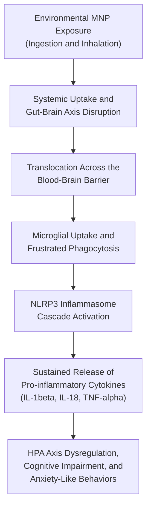

# Micro- and Nanoplastics: Crossing the Blood-Brain Barrier to Drive Sustained Neuroinflammation and HPA Axis Dysregulation

This repository hosts the manuscript source, bibliography, visual assets, and rendering configuration for an academic review on the neurotoxic and endocrine effects of environmental micro- and nanoplastics (MNPs). The paper was prepared for the Immunology course (BT335IU) at the School of Biotechnology, International University – Vietnam National University, Ho Chi Minh City.

The manuscript is written in Quarto Markdown (`.qmd`) and formats into a Microsoft Word (`.docx`) document using a locally bundled Hikmah Academic manuscript template and Elsevier Vancouver citation styling.

---

## Quick Access for Readers

If you only want to read the paper, you do not need to install any coding tools, R packages, or command-line utilities.

| File | Description | Recommended For |
|:---|:---|:---|
| `final_25AU IM Group Trần Quốc Hoàng (just me).docx` | Final compiled manuscript with figures, formatted tables, and numbered references. | Reading, grading, reviewing, or sharing via Microsoft Word, LibreOffice, or Google Docs. |
| `old_before_format_change_25AU IM Group Trần Quốc Hoàng (just me).docx` | Archived earlier draft prior to style adjustments. | Reference and version comparison. |
| `TranQuocHoang_IM25_Newsletter.qmd` | Raw Quarto source file containing text, academic metadata, and code chunk headers. | Editing, compiling from source, or examining reproducible formatting. |

---

## Manuscript Overview

### Academic Context

| Detail | Description |
|:---|:---|
| Title | Micro- and Nanoplastics: Crossing the Blood-Brain Barrier to Drive Sustained Neuroinflammation and HPA Axis Dysregulation |
| Course | Immunology (BT335IU) |
| Institution | School of Biotechnology, International University – VNU-HCM |
| Author | Tran Quoc Hoang (Student ID: BTBTWE24036) |
| Academic Advisor | Assoc. Prof. Hoai T. T. Nguyen |
| Date | December 2025 |
| Keywords | Microplastic, Nanoplastic, Neuroinflammation, Microglia, Gut-Brain Axis, HPA Axis |

### Abstract Summary

Micro- and nanoplastics (MNPs) represent pervasive environmental pollutants that enter mammalian organisms via inhalation and ingestion. Due to their nanoscale size, nanoplastics can cross biological membranes, notably the Blood-Brain Barrier (BBB), through endocytic pathways and the "Trojan Horse" mechanism. 

Inside the central nervous system, non-degradable particles induce persistent microglial activation through frustrated phagocytosis, which triggers the NLRP3 inflammasome cascade and the sustained release of pro-inflammatory cytokines (IL-1beta, IL-18, TNF-alpha). In parallel, peripheral gut exposure stimulates gut-brain axis signaling and systemic inflammation. Together, these processes drive Hypothalamic-Pituitary-Adrenal (HPA) axis dysregulation, elevated baseline glucocorticoids, anxiety-like behaviors, and cognitive deficits.

### Mechanistic Pathway



### Key Sections

| Section | Focus and Scope |
|:---|:---|
| 1. Introduction | Global plastic contamination, physical classification (micro vs. nano), and physiological entry points. |
| 2. MP Transport & BBB Crossing | Structural biology of the BBB, passive vs. active translocation, corona formation, and associated chemical plasticizers. |
| 3. Microglial Activation & Neuroinflammation | Immune surveillance in the CNS, frustrated phagocytosis mechanisms, and NLRP3 inflammasome assembly. |
| 4. Gut-Brain Axis & Indirect Effects | Vagus nerve signaling, gut dysbiosis, systemic inflammatory mediators entering through compromised barriers. |
| 5. Functional Consequences & HPA Disruption | Behavioral alterations, chronic HPA axis hyperactivation, and endocrine feedback disruption. |
| 6. Treatment & Prevention | Environmental remediation, policy frameworks, and biomedical strategies (such as brain-permeable NLRP3 inhibitors). |
| 7. Conclusion & Future Directions | Knowledge gaps in human chronic low-dose exposure and priorities for translational research. |

---

## Repository Structure

| File or Folder | Purpose | Notes |
|:---|:---|:---|
| `TranQuocHoang_IM25_Newsletter.qmd` | Main manuscript source file | Written in Quarto Markdown; contains YAML metadata and text sections. |
| `bibliography.bib` | Reference database | BibTeX file holding all literature citations. |
| `elsevier-vancouver.csl` | Citation stylesheet | Formats references according to Elsevier Vancouver specifications. |
| `elsevier-vancouver-short-author-list.csl` | Alternative citation style | Formatted variant with truncated author lists. |
| `vancouver.csl` | Standard Vancouver stylesheet | Standard numerical biomedical citation style. |
| `photos/` | Image and diagram directory | Contains mechanistic illustrations referenced in the paper. |
| `_extensions/` | Bundled Quarto template | Contains the locally vendored Hikmah Academic Word manuscript extension. |
| `renv.lock` | R dependency manifest | Specifies exact versions of R packages needed for reproducible rendering. |
| `renv/` | R environment bootstrap | Scripts to activate and manage the isolated R library. |
| `final_25AU IM Group Trần Quốc Hoàng (just me).docx` | Pre-rendered Word manuscript | Ready-to-read final output. |

---

## Reproducing or Editing the Document

For wet-lab researchers who wish to modify the text, update citations, or regenerate the `.docx` document from the source file, follow the instructions below.

### Prerequisites

| Tool | Recommended Version | Purpose | Download |
|:---|:---|:---|:---|
| R | 4.0 or newer | R runtime environment | [cran.r-project.org](https://cran.r-project.org/) |
| RStudio Desktop | Latest stable release | Graphical interface for editing and rendering | [posit.co/download/rstudio-desktop](https://posit.co/download/rstudio-desktop/) |
| Quarto CLI | 1.3 or newer | Scientific publishing engine | [quarto.org/docs/get-started](https://quarto.org/docs/get-started/) |
| Microsoft Word or LibreOffice | Any modern release | Viewing and reviewing the rendered `.docx` | [libreoffice.org](https://www.libreoffice.org/) |

> [!NOTE]
> You do **not** need to install LaTeX, MacTeX, or MikTeX to compile this manuscript because the output target is a Microsoft Word document (`.docx`).

---

### Method 1: Using RStudio (Recommended for Lab Members)

This method provides a graphical interface and is the most straightforward approach if you are accustomed to working in RStudio.

1. **Clone or Download the Repository**
    * Download the repository as a ZIP archive and extract it, or clone the repository via Git:
      ```bash
      git clone https://github.com/ht2905/microplastic-neurotoxicity-paper.git
      ```

2. **Open the Project in RStudio**
    * Launch RStudio.
    * In the top-right menu, select **File > Open Project...** and choose the downloaded repository directory (or open RStudio directly inside this directory).

3. **Restore R Packages via `renv`**
    * The project uses `renv` to guarantee package version compatibility.
    * In the RStudio **Console** tab, run:
      ```r
      renv::restore()
      ```
    * When prompted with `Do you want to proceed? [y/N]`, type `y` and press Enter. R will automatically install the exact versions of the rendering libraries (`knitr`, `rmarkdown`, `yaml`, `ragg`).

4. **Open and Render the Manuscript**
    * In the **Files** pane (bottom-right of RStudio), click on `TranQuocHoang_IM25_Newsletter.qmd` to open it in the editor.
    * Click the **Render** button (blue arrow icon) at the top of the editor pane, or press `Ctrl+Shift+K` (Windows/Linux) or `Cmd+Shift+K` (macOS).
    * Quarto will process the markdown, cross-reference figures, format the citations according to `elsevier-vancouver.csl`, and generate `TranQuocHoang_IM25_Newsletter.docx`.

---

### Method 2: Using the Command Line (Terminal)

If you prefer working directly in a shell environment:

1. **Navigate to the Project Root**
    ```bash
    cd microplastic-neurotoxicity-paper
    ```

2. **Install or Restore R Dependencies**
    ```bash
    Rscript -e "renv::restore()"
    ```

3. **Verify Quarto Installation**
    ```bash
    quarto check install
    ```

4. **Render the Document to Word**
    ```bash
    quarto render TranQuocHoang_IM25_Newsletter.qmd
    ```

    The generated document will be saved in the root folder as `TranQuocHoang_IM25_Newsletter.docx`.

---

## Troubleshooting Guide for Wet-Lab Scientists

| Issue | Cause | Solution |
|:---|:---|:---|
| `quarto: command not found` | Quarto CLI is not installed or not added to your system PATH. | Download and run the Quarto installer from [quarto.org](https://quarto.org/docs/get-started/). Restart RStudio or your terminal after installing. |
| `renv::restore()` fails on binary download | Network restriction or outdated R repository mirror. | Run `options(repos = c(CRAN = "https://cloud.r-project.org"))` in the R console, then re-run `renv::restore()`. |
| Missing Quarto extensions error | Quarto template not detected. | Ensure the `_extensions/` folder is present in the repository root. This project already bundles the template locally; you do not need to install it from GitHub. |
| Permission error when opening `.docx` after render | The Word document is currently open in Microsoft Word. | Close Microsoft Word before running the render command so that Quarto can overwrite the output file. |
| Figures fail to appear in the output | Changed image paths or missing files. | Verify that the image files remain inside the `photos/` directory with their original filenames (`entry-routes.jpeg`, `gut-brain-axis.jpg`, etc.). |

---

## Competing Interests

The author declares no competing financial, personal, or professional interests.

---

## Citation and Contact

If you use or adapt this manuscript or Quarto structure, please cite:

```bibtex
@misc{tran2025microplastics,
    author       = {Tran, Quoc Hoang},
    title        = {Micro- and Nanoplastics: Crossing the Blood-Brain Barrier to Drive Sustained Neuroinflammation and HPA Axis Dysregulation},
    year         = {2025},
    howpublished = {School of Biotechnology, International University - VNU-HCM},
    note         = {Immunology Coursework (BT335IU)}
}
```

* **Author:** Tran Quoc Hoang
* **Affiliation:** School of Biotechnology, International University – Vietnam National University, Ho Chi Minh City
* **Email:** tranquochoang@protonmail.com
* **Repository:** [https://github.com/ht2905/microplastic-neurotoxicity-paper](https://github.com/ht2905/microplastic-neurotoxicity-paper)
