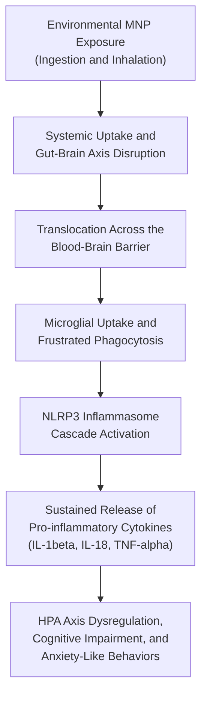

# Micro- and Nanoplastics: Crossing the Blood-Brain Barrier to Drive Sustained Neuroinflammation and HPA Axis Dysregulation

This repository hosts the manuscript source, bibliography database, visual figures, and publishing configuration for an academic review on the neurotoxic and endocrine effects of environmental micro- and nanoplastics (MNPs). The paper was prepared for the Immunology course (BT335IU) at the School of Biotechnology, International University – Vietnam National University, Ho Chi Minh City.

The manuscript is authored in Quarto Markdown (`microplastic-neurotoxicity_manuscript.qmd`) and compiles to Microsoft Word (`.docx`) using a locally vendored Hikmah Academic manuscript template and Elsevier Vancouver citation formatting.

---

## Quick Access for Readers

The manuscript can be read in plain-text directly on GitHub, downloaded as a pre-compiled document via GitHub Actions artifacts, or compiled locally with a single command.

| Access Method | Description | Target Format |
|:---|:---|:---|
| **Direct Download (GitHub Actions)** | Download the latest compiled Word document directly from the repository's GitHub Actions build artifacts. | Word document (`.docx`) |
| **Local Render (1-Command)** | Run `quarto render microplastic-neurotoxicity_manuscript.qmd` on your machine. | Word document (`.docx`) |
| **Read Source Markdown** | Open `microplastic-neurotoxicity_manuscript.qmd` in any text editor, Obsidian, or directly in GitHub. | Plain-text Markdown (`.qmd`) |

---

## Manuscript Overview

### Academic Context

| Detail | Description |
|:---|:---|
| Title | Micro- and Nanoplastics: Crossing the Blood-Brain Barrier to Drive Sustained Neuroinflammation and HPA Axis Dysregulation |
| Course | Immunology (BT335IU) |
| Institution | School of Biotechnology, International University – VNU-HCM |
| Author | Tran Quoc Hoang (Student ID: BTBTWE24036) |
| Academic Advisor | Assoc. Prof. Hoai T. T. Nguyen |
| Date | December 2025 |
| Keywords | Microplastic, Nanoplastic, Neuroinflammation, Microglia, Gut-Brain Axis, HPA Axis |

### Abstract Summary

Micro- and nanoplastics (MNPs) represent pervasive environmental pollutants that enter mammalian organisms via inhalation and ingestion. Due to their nanoscale size, nanoplastics can cross biological membranes, notably the Blood-Brain Barrier (BBB), through endocytic pathways and the "Trojan Horse" mechanism. 

Inside the central nervous system, non-degradable particles induce persistent microglial activation through frustrated phagocytosis, which triggers the NLRP3 inflammasome cascade and the sustained release of pro-inflammatory cytokines (IL-1beta, IL-18, TNF-alpha). In parallel, peripheral gut exposure stimulates gut-brain axis signaling and systemic inflammation. Together, these processes drive Hypothalamic-Pituitary-Adrenal (HPA) axis dysregulation, elevated baseline glucocorticoids, anxiety-like behaviors, and cognitive deficits.

### Mechanistic Pathway



### Key Sections

| Section | Focus and Scope |
|:---|:---|
| 1. Introduction | Global plastic contamination, physical classification (micro vs. nano), and physiological entry points. |
| 2. MP Transport & BBB Crossing | Structural biology of the BBB, passive vs. active translocation, corona formation, and associated chemical plasticizers. |
| 3. Microglial Activation & Neuroinflammation | Immune surveillance in the CNS, frustrated phagocytosis mechanisms, and NLRP3 inflammasome assembly. |
| 4. Gut-Brain Axis & Indirect Effects | Vagus nerve signaling, gut dysbiosis, systemic inflammatory mediators entering through compromised barriers. |
| 5. Functional Consequences & HPA Disruption | Behavioral alterations, chronic HPA axis hyperactivation, and endocrine feedback disruption. |
| 6. Treatment & Prevention | Environmental remediation, policy frameworks, and biomedical strategies (such as brain-permeable NLRP3 inhibitors). |
| 7. Conclusion & Future Directions | Knowledge gaps in human chronic low-dose exposure and priorities for translational research. |

---

## Repository Structure

| File or Folder | Purpose | Notes |
|:---|:---|:---|
| `microplastic-neurotoxicity_manuscript.qmd` | Main manuscript source file | Self-contained Quarto Markdown file containing text, academic metadata, and figure references. |
| `bibliography.bib` | Reference database | BibTeX file containing all cited literature entries. |
| `csl/elsevier-vancouver.csl` | Citation stylesheet | Formats references according to Elsevier Vancouver specifications. |
| `figures/` | Visual figure assets | High-resolution diagrams illustrating BBB crossing, microglial activation, and HPA axis disruption. |
| `_extensions/andrewheiss/hikmah-manuscript/` | Bundled Quarto template | Locally vendored Hikmah Academic Word manuscript styling extension. |
| `_quarto.yml` | Project configuration | Defines project-level render targets and default formatting. |
| `.github/workflows/render-manuscript.yml` | Continuous integration | Automated GitHub Action that compiles the manuscript on push. |

---

## Reproducing or Editing the Document

The repository is optimized for zero-dependency native Quarto compilation. Because the manuscript contains no embedded computational code chunks or statistical simulations, **no R, Python, or package manager installation is required.**

### Prerequisites

| Tool | Recommended Version | Purpose | Download |
|:---|:---|:---|:---|
| Quarto CLI | 1.3 or newer | Scientific publishing engine | [quarto.org/docs/get-started](https://quarto.org/docs/get-started/) |
| Microsoft Word or LibreOffice | Any modern release | Reviewing and viewing the compiled `.docx` | [libreoffice.org](https://www.libreoffice.org/) |
| Git (Optional) | Any modern release | Cloning the repository | [git-scm.com](https://git-scm.com/) |

> [!NOTE]
> You do **not** need R, RStudio, `renv`, or a LaTeX distribution (such as MacTeX or MikTeX) to compile this paper. Quarto compiles the `.qmd` source directly to `.docx` via its embedded Pandoc engine.

---

### Step-by-Step Local Compilation

1. **Clone or Download the Repository**
    * Clone via Git:
      ```bash
      git clone https://github.com/ht2905/microplastic-neurotoxicity-paper.git
      cd microplastic-neurotoxicity-paper
      ```
    * Alternatively, download and extract the repository ZIP from GitHub.

2. **Render the Manuscript**
    * Open your terminal in the repository folder and run:
      ```bash
      quarto render
      ```
    * Or specify the manuscript file directly:
      ```bash
      quarto render microplastic-neurotoxicity_manuscript.qmd
      ```
    * Quarto will process the markdown text, resolve the citations against `bibliography.bib`, apply the CSL style, and generate `microplastic-neurotoxicity_manuscript.docx`.

3. **Rendering within RStudio or VS Code (GUI Option)**
    * If you prefer using RStudio or VS Code, simply open `microplastic-neurotoxicity_manuscript.qmd` and click the **Render** button in the top toolbar.

---

## Troubleshooting Guide for Wet-Lab Scientists

| Issue | Cause | Solution |
|:---|:---|:---|
| `quarto: command not found` | Quarto CLI is not installed or not added to your system PATH. | Download and run the Quarto installer from [quarto.org](https://quarto.org/docs/get-started/). Restart your terminal or editor after installing. |
| Permission error when running `quarto render` | The generated `.docx` file is currently open in Microsoft Word. | Close Microsoft Word before running the render command so that the output file can be overwritten. |
| Figures fail to render in document | Image path mismatch or missing figure assets. | Confirm that the figure files exist in `figures/` with their expected names (`mnp_entry-routes.jpeg`, `microglia_activation-states.jpg`, etc.). |
| Extension not recognized | Rendering from a subfolder rather than root. | Always run `quarto render` from the root directory of the repository where `_extensions/` and `_quarto.yml` reside. |

---

## Competing Interests

The author declares no competing financial, personal, or professional interests.

---

## Citation and Contact

If you use or adapt this manuscript or Quarto structure, please cite:

```bibtex
@misc{tran2025microplastics,
    author       = {Tran, Quoc Hoang},
    title        = {Micro- and Nanoplastics: Crossing the Blood-Brain Barrier to Drive Sustained Neuroinflammation and HPA Axis Dysregulation},
    year         = {2025},
    howpublished = {School of Biotechnology, International University - VNU-HCM},
    note         = {Immunology Coursework (BT335IU)}
}
```

* **Author:** Tran Quoc Hoang
* **Affiliation:** School of Biotechnology, International University – Vietnam National University, Ho Chi Minh City
* **Email:** tranquochoang@protonmail.com
* **Repository:** [https://github.com/ht2905/microplastic-neurotoxicity-paper](https://github.com/ht2905/microplastic-neurotoxicity-paper)
